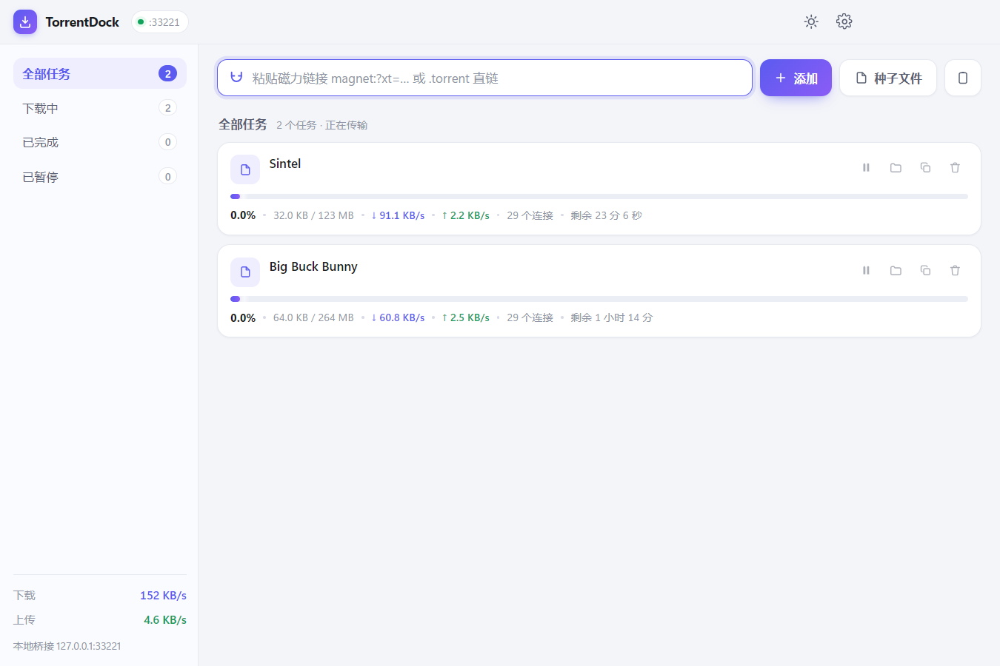
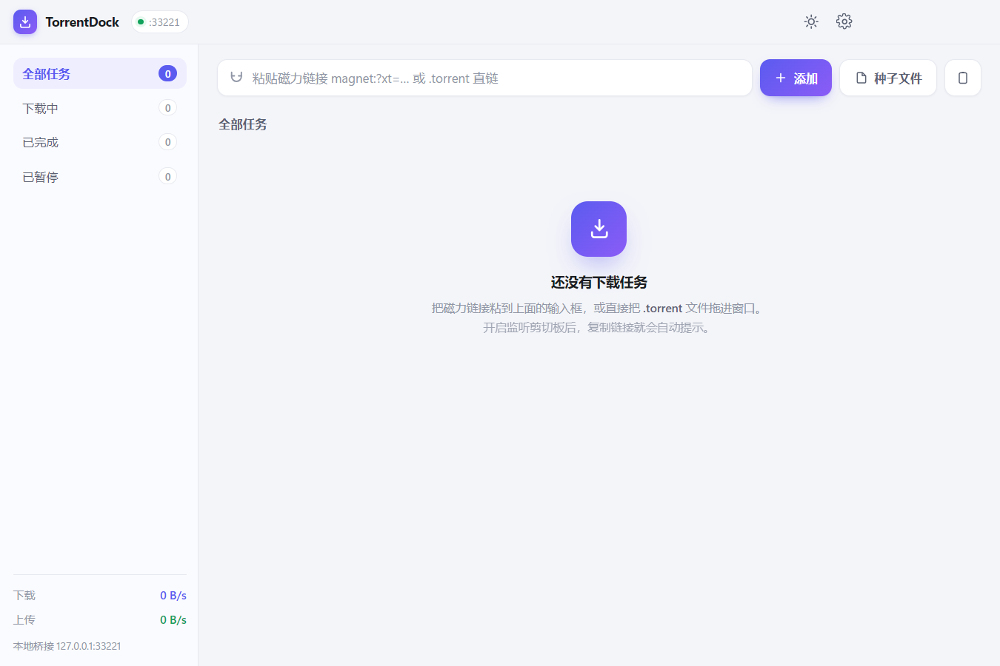
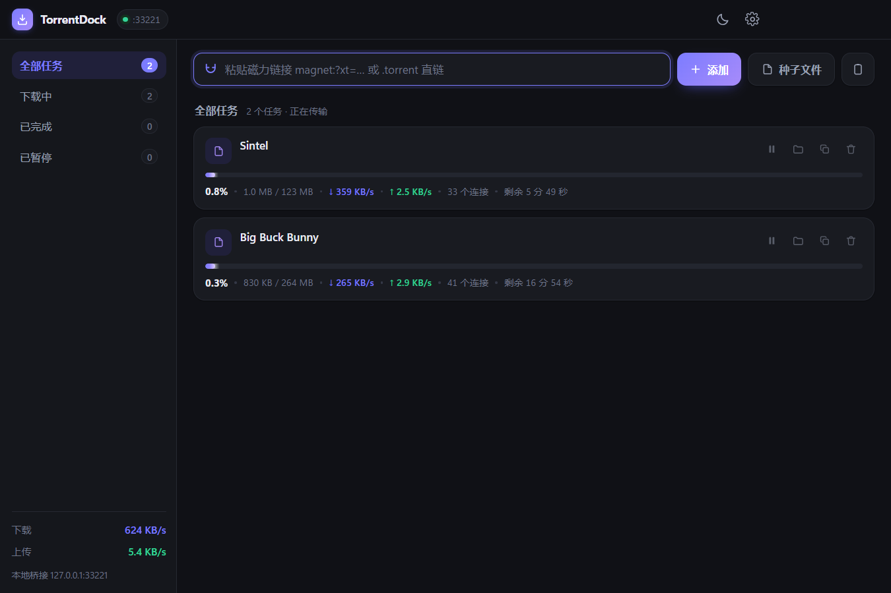
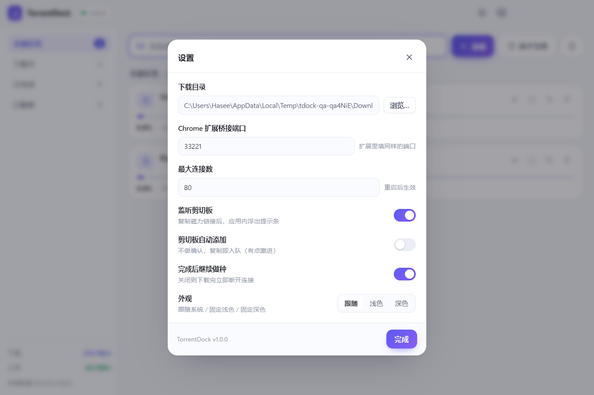

<div align="center">

# TorrentDock

**一个干净、无广告、不弹会员的桌面种子下载器**

Electron 31 · WebTorrent 1.9 · 原生 HTML/CSS/JS · 零前端框架


</div>

---

## 重要声明

> **本项目仅供个人学习与技术研究使用。**
>
> - **禁止任何形式的商业使用**（销售、集成进商业产品、付费服务、广告变现等）。
> - **禁止用于任何违法犯罪活动**，禁止下载或传播法律法规禁止的内容，禁止侵犯他人知识产权。
> - 本项目只是一个 BitTorrent 协议客户端，**不提供、不托管、不索引、不分发任何内容**，所有下载内容均来自使用者自行添加的链接与第三方网络节点。
> - 使用者须自行承担使用本项目的全部风险与全部法律责任。**作者与贡献者对任何直接或间接损失、法律纠纷、行政处罚概不负责，亦不承担任何连带责任。**
>
> 若不同意上述任一条件，请立即停止使用并删除本项目全部副本。完整条款见 [LICENSE](LICENSE)。

---

## 目录

- [为什么做这个](#为什么做这个)
- [功能特性](#功能特性)
- [界面](#界面)
- [快速开始](#快速开始)
- [打包发布](#打包发布)
- [Chrome 扩展](#chrome-扩展)
- [使用指南](#使用指南)
- [架构设计](#架构设计)
- [目录结构](#目录结构)
- [数据存放位置](#数据存放位置)
- [常见问题](#常见问题)
- [开发与测试](#开发与测试)
- [路线图](#路线图)
- [技术栈](#技术栈)
- [许可](#许可)

---

## 为什么做这个

市面上的下载器要么塞满广告弹窗、要么把基础功能锁进"会员加速"、要么偷偷装一堆全家桶。

而这个东西需要的功能其实很简单：**给我一个磁力链接，把它下下来。**

于是有了 TorrentDock：没有广告、没有账号、没有会员体系，只有任务列表、进度条和速度。所有代码都在这个仓库里，你可以自己看它到底做了什么——包括它没有把任何数据发到任何服务器。

## 功能特性

| 能力 | 说明 |
| --- | --- |
| 磁力链接 | 直接粘贴 `magnet:?xt=urn:btih:...` |
| 种子文件 | 支持 `.torrent` 本地文件、拖拽进窗口、`.torrent` 直链 |
| 剪切板自动识别 | 复制磁力链接后应用内浮出提示条，一键添加；也可设为"复制即入队" |
| Chrome 扩展 | 右键发送、页面磁力链接旁的「↓」按钮、工具栏弹窗发送 |
| 任务管理 | 暂停 / 继续 / 打开文件夹 / 复制磁力 / 移除（按住 <kbd>Alt</kbd> 连同文件删除） |
| 断点续传 | 任务列表持久化，重开应用自动恢复，**默认暂停态**不偷跑流量 |
| 实时信息 | 进度、已下载/总大小、上下行速度、连接数、剩余时间 |
| 主题 | 浅色 / 深色 / 跟随系统 |
| 无边框界面 | Windows 用原生窗口控件叠加，macOS 用交通灯 |

## 界面

主界面（浅色）：



| 空状态 | 深色模式 | 设置面板 |
| :---: | :---: | :---: |
|  |  |  |

三栏式布局：左侧筛选与实时速率，中间任务列表，顶部一体化添加栏。

---

## 快速开始

### 环境要求

- Node.js **18+**（建议 20 / 22）
- npm 9+
- Windows 10+ 或 macOS 11+

### 开发运行

```bash
git clone https://github.com/venux/torrent-downloader.git
cd torrent-downloader
npm install
npm start          # 或 npm run dev（自动打开 DevTools）
```

首次启动会在系统「下载」目录下创建 `TorrentDock` 文件夹作为默认下载目录，可以在设置里改。

> **注意**：如果你的终端环境里设置了 `ELECTRON_RUN_AS_NODE=1`（某些 IDE / 工具链会设），Electron 会被当成普通 Node 运行，报
> `Cannot read properties of undefined (reading 'getPath')`。用 `env -u ELECTRON_RUN_AS_NODE npm start` 启动，或先取消该环境变量。

## 打包发布

```bash
npm run dist:win     # Windows → release/*.exe (NSIS 安装包)
npm run dist:mac     # macOS   → release/*.dmg (x64 + arm64)
npm run dist         # 当前平台
```

打包过程中会先产出 `release/win-unpacked/`，这是一个**免安装绿色版**，双击 `TorrentDock.exe` 即可运行。

**macOS 注意事项**

- dmg 只能在 macOS 上构建（需要 codesign 工具链），Windows 上交叉打包会失败。
- 没有 Apple 开发者证书时产物未签名，首次打开需右键 → 打开，或执行：

```bash
xattr -dr com.apple.quarantine /Applications/TorrentDock.app
```

**Windows 打包报 `Cannot create symbolic link : 客户端没有所需的特权`**

这是 electron-builder 解压签名工具时需要创建符号链接、而当前账户无此权限导致的（与代码无关）。二选一：

1. 打开「设置 → 系统 → 开发者选项 → **开发人员模式**」，然后重跑；
2. 用**管理员身份**打开终端再执行 `npm run dist:win`。

该步骤只影响 NSIS 安装包，`release/win-unpacked/` 里的绿色版在此之前已生成，不受影响。

---

## Chrome 扩展

扩展位于 [`extension/`](extension)，Manifest V3，无任何第三方依赖。

### 安装

1. 打开 `chrome://extensions/`，右上角开启 **开发者模式**；
2. 点 **加载已解压的扩展程序**，选择本仓库的 `extension/` 目录；
3. 打开 TorrentDock 桌面端，扩展弹窗里应显示 `已连接 127.0.0.1:33221`。

### 四种触发方式

| 方式 | 操作 |
| --- | --- |
| 右键链接 | 任意链接上右键 → 「发送此链接到 TorrentDock」 |
| 右键选中文字 | 选中一段含磁力链接的文字 → 右键发送 |
| 页面内按钮 | 页面中的磁力链接旁会自动出现紫色「↓」小按钮 |
| 工具栏弹窗 | 点扩展图标，自动读取剪切板 / 手动粘贴后发送 |

### 端口不一致怎么办

桌面端端口被占用时会自动顺延（33222、33223…），**标题栏徽标上显示的数字就是真实端口**。把它填进扩展弹窗底部的端口输入框，点保存即可。

### 权限说明

扩展申请了 `clipboardRead`（读取剪切板）、`contextMenus`（右键菜单）、`notifications`（发送结果通知）以及对 `127.0.0.1` 的访问权限。此外 `content_scripts` 会注入到所有 http/https 页面，**仅用于在磁力链接旁渲染那个「↓」按钮并读取页面里的磁力链接**，不会收集或上传任何页面内容。

---

## 使用指南

### 四种添加方式

1. 顶部输入框粘贴后按 <kbd>Enter</kbd>；
2. 焦点不在输入框时直接按 <kbd>Ctrl/⌘</kbd> + <kbd>V</kbd>，会读剪切板并直接提交；
3. 复制磁力链接 → 应用内浮出提示条 → 点「添加」；
4. 把 `.torrent` 文件拖进窗口，或用「种子文件」按钮多选。

### 快捷操作

| 操作 | 说明 |
| --- | --- |
| 点击卡片上的 ⏸ / ▶ | 暂停 / 继续 |
| 按住 <kbd>Alt</kbd> 点垃圾桶 | 移除任务**并删除已下载文件**（普通点击只移除任务，文件保留） |
| 点齿轮 | 设置：下载目录、桥接端口、最大连接数、剪切板策略、主题 |
| <kbd>Esc</kbd> | 关闭设置面板 |

### 剪切板策略

- **监听剪切板**（默认开）：复制链接后弹提示条，确认才添加，最稳妥；
- **剪切板自动添加**（默认关）：复制即入队，适合连续添加的场景。

两个开关互不冲突：关掉监听则完全不轮询剪切板。

---

## 架构设计

```
┌──────────────────┐   HTTP (127.0.0.1:33221)   ┌─────────────────────────────┐
│  Chrome 扩展      │ ─────────────────────────▶ │  主进程 (Node)               │
│  MV3 service     │ ◀───── JSON ────────────── │  ├─ bridge-server  本地 API  │
│  worker          │                            │  ├─ TorrentManager WebTorrent│
└──────────────────┘                            │  ├─ clipboard-watcher        │
                                                │  └─ store  JSON 配置          │
┌──────────────────┐      IPC (contextBridge)   │                             │
│  渲染进程         │ ◀────────────────────────▶ │                             │
│  原生 DOM         │      每秒推送状态快照        └─────────────────────────────┘
└──────────────────┘
```

几个刻意的设计选择：

**1. 下载内核与 Electron 完全解耦**

`src/main/torrent-manager.js` 只依赖 WebTorrent 与 Node 标准库，不 import 任何 Electron API。因此它可以脱离 Electron 直接被 Node 跑起来做测试（见 `npm run test:core`）。将来换 UI 框架、加 CLI、做无头服务都不用动内核。

**2. 渲染进程零 Node 权限**

`contextIsolation: true` + `nodeIntegration: false` + CSP 限制，能力全部通过 `preload.js` 的白名单 API 暴露。渲染层拿不到 `require`，拿不到 `fs`。

**3. 桥接服务只监听回环地址**

绑定 `127.0.0.1` 意味着局域网和公网都访问不到。CORS 只对 `chrome-extension://`、`moz-extension://`、`localhost` 回显来源，普通网页的 JS 调不动你的下载器。

**4. 状态同步用"推"而不是"拉"**

主进程每秒把整个列表快照推给渲染进程，渲染层做 keyed 增量更新（按 infoHash 复用 DOM 节点），进度条靠 CSS `width` 过渡，不重建节点、不闪烁。

**5. 重复种子的清理**

WebTorrent 遇到重复 infoHash 时不会同步抛错，而是异步销毁新对象并通过 `error` 事件冒泡。本项目在 `client.add()` 之后**立即**挂载 error 监听器并做自己的 infoHash 去重，避免未捕获的 error 事件把进程带走。

## 目录结构

```
torrent-downloader/
├── src/
│   ├── main/                    # 主进程（Node 环境）
│   │   ├── main.js              # 生命周期、窗口、IPC 注册
│   │   ├── torrent-manager.js   # WebTorrent 封装（不依赖 Electron，可单测）
│   │   ├── bridge-server.js     # 本地 HTTP 桥接，供 Chrome 扩展调用
│   │   ├── clipboard-watcher.js # 剪切板轮询与磁力链接识别
│   │   └── store.js             # 原子写的 JSON 配置存储
│   ├── preload/
│   │   └── preload.js           # contextBridge 白名单 API
│   └── renderer/                # 界面：原生 HTML / CSS / JS
│       ├── index.html
│       ├── styles.css
│       └── app.js
├── extension/                   # Chrome MV3 扩展
│   ├── manifest.json
│   ├── background.js            # 右键菜单 + 调用本地 API + 通知
│   ├── content.js / .css        # 页面内「↓」按钮
│   ├── popup.html / .css / .js  # 工具栏弹窗
│   └── icons/
├── tools/
│   ├── make-icons.js            # 纯 Node 手写 PNG 编码生成图标
│   ├── test-core.js             # 24 项端到端自检
│   └── qa-shots.js              # 启动真实应用自动出图（视觉回归）
├── build/                       # 打包用图标
├── docs/                        # README 截图
├── LICENSE
└── package.json
```

## 数据存放位置

| 内容 | Windows | macOS |
| --- | --- | --- |
| 配置 `settings.json` | `%APPDATA%\TorrentDock\` | `~/Library/Application Support/TorrentDock/` |
| 任务历史 `history.json` | 同上 | 同上 |
| 下载文件 | `%USERPROFILE%\Downloads\TorrentDock` | `~/Downloads/TorrentDock` |

配置是纯 JSON，直接删掉即可恢复出厂设置（不会删除已下载的文件）。

---

## 常见问题

**Q：速度很慢，或者一直是 0 连接？**

BT 速度取决于种子热度与网络环境。冷门种子需要靠 DHT 找到 peer，可能要等几分钟。另外很多代理默认只代理 TCP，而 BT 大量依赖 UDP/uTP，需要确认 UDP 也走了代理。部分地区运营商对 BT 有干扰，这属于网络环境问题，不是客户端能解决的。

**Q：端口 33221 被占用？**

应用会自动顺延尝试 33222、33223…，标题栏徽标显示的就是真实端口。把它填进 Chrome 扩展即可。

**Q：扩展显示"未连接桌面端"？**

① 桌面端没启动；② 端口不一致；③ 有安全软件拦截本地回环请求。扩展弹窗里能看到具体的端口号。

**Q：下载到一半没速度了？**

点暂停再继续，会重新发起 tracker 连接。如果种子本身已经没人做种，那就确实下不完了。

**Q：会被版权方追踪吗？**

会。BT 是公开协议，你的 IP 对其他 peer 是可见的——这正是**只能用于你有权获取的内容**的原因（Linux 发行版镜像、开源素材、自己的文件分发等）。

**Q：能只下压缩包里的某几个文件吗？**

目前还不支持文件级选择，见[路线图](#路线图)。内核里 `manager.files()` 接口已经预留好了。

## 开发与测试

```bash
npm run test:core    # 24 项端到端自检，不依赖 Electron
npm run icons        # 重新生成应用与扩展图标（纯 Node，无需图形库）
node tools/qa-shots.js ./docs/shot   # 启动真实应用自动截图，做视觉回归
```

`test:core` 覆盖的范围：

```
[1] 下载内核      ✓ 内核启动  ✓ 添加磁力  ✓ infoHash  ✓ 去重  ✓ 暂停/继续
[2] 桥接服务      ✓ ping  ✓ 列表  ✓ 添加  ✓ CORS 回显  ✓ OPTIONS 预检  ✓ 错误处理
[3] 种子文件      ✓ .torrent 缓冲区  ✓ 文件名解析  ✓ 重复不入列
[4] 剪切板识别    ✓ 5 组文本样本（磁力 / 直链 / 干扰文本 / 普通文字）
[5] 清理

结果：24 通过 / 0 失败
```

### 调试技巧

- `npm run dev` 会自动打开 DevTools；
- 浏览器打开 `http://127.0.0.1:33221/` 能看到桥接服务的状态页，`/api/ping`、`/api/torrents` 可直接看 JSON；
- 渲染层没有构建步骤，改完 `src/renderer/` 下的文件，按 <kbd>Ctrl/⌘</kbd> + <kbd>R</kbd> 即可看到效果。

## 路线图

- [ ] 系统托盘常驻 + 关闭到托盘
- [ ] 单任务限速 / 定时限速
- [ ] 文件级选择（只下种子里的部分文件）
- [ ] 做种统计与分享率面板
- [ ] `electron-updater` 自动更新
- [ ] 磁力链接二维码（手机扫码接力）

## 技术栈

| 层 | 选型 | 说明 |
| --- | --- | --- |
| 桌面壳 | Electron 31 | 主进程 Node 20，渲染进程 Chromium 126 |
| BT 内核 | WebTorrent 1.9.7 | 纯 JS，支持 DHT / PEX / LSD / uTP |
| 界面 | 原生 DOM + CSS | 无框架、无构建步骤 |
| 扩展 | Chrome MV3 | 原生 JS，无打包 |
| 打包 | electron-builder 24 | NSIS / DMG |

> 为什么用 WebTorrent 1.x 而不是 2.x：2.x 是纯 ESM，主进程需切换到 ESM 才能 `import`，而 Electron 的 ESM 主进程在原生依赖加载顺序上仍有坑。1.9.7 是最后的 CJS 稳定版本，功能足够。

## 许可

本项目采用自定义的 [个人学习许可](LICENSE)：

- ✅ 个人学习、研究、阅读、编译、运行
- ❌ **任何形式的商业使用**
- ❌ **任何违法犯罪用途**
- ❌ 移除版权与许可声明

**本软件按"现状"提供，不附带任何担保。使用者须自行承担全部风险与法律责任，作者与贡献者概不负责。**

---

<div align="center">
<sub>如果这个项目对你的学习有帮助，欢迎点个 star。</sub>
</div>
